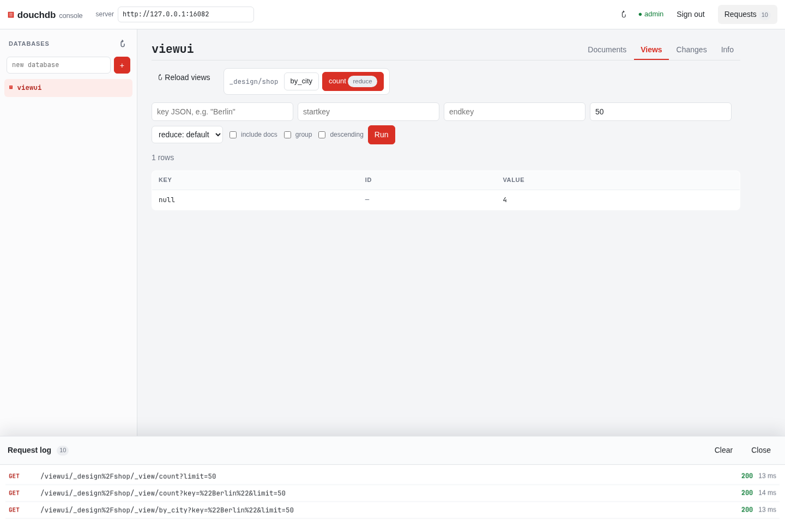

# douchdb

A small CouchDB **wire-compatible** document database in Rust, stored on
LevelDB, runnable as a Q-shard × N-replica cluster.

The goal is not to reimplement all of CouchDB. It is a server that PouchDB and
CouchDB can replicate against in both directions, with CouchDB-compatible
revision ids, HTTP shapes and status codes. Map/reduce views run on an embedded
QuickJS engine; Mango, `_replicator`, lists and shows are not implemented.

See [PLAN.md](PLAN.md) for the design, decisions and known limits.

## Quick start

```sh
cargo build --release
./target/release/douchdb
```

That listens on `127.0.0.1:5984` and stores data in `./data`. With no
`--admin`, authentication is disabled.

```sh
curl -X PUT localhost:5984/demo
curl -X PUT localhost:5984/demo/doc1 \
  -H 'Content-Type: application/json' \
  -d '{"hello":"world"}'
curl localhost:5984/demo/doc1
curl 'localhost:5984/demo/_all_docs?include_docs=true'
curl 'localhost:5984/demo/_changes'
```

PouchDB can replicate to and from it directly:

```js
const local = new PouchDB('local');
const remote = new PouchDB('http://localhost:5984/demo');
local.replicate.to(remote);
local.replicate.from(remote);
```

CouchDB can push a database into douchdb using CouchDB's own `_replicate`
(douchdb does not implement `_replicate` itself; clients drive replication):

```sh
# Run against the CouchDB node; `source` is a database on that node.
curl -X POST http://couch:5984/_replicate \
  -H 'Content-Type: application/json' \
  -d '{"source":"source","target":"http://douchdb:5984/demo"}'
```

## Views

Views live in design documents and run JavaScript map/reduce functions on the
embedded QuickJS engine. Start with a small database:

```sh
curl -X PUT localhost:5984/shop
curl -X POST localhost:5984/shop/_bulk_docs \
  -H 'Content-Type: application/json' \
  -d '{"docs":[
        {"_id":"a","city":"Berlin","tags":["book"],"price":10},
        {"_id":"b","city":"Berlin","tags":["book","sale"],"price":20},
        {"_id":"c","city":"Paris","tags":["music"],"price":5},
        {"_id":"d","city":"Paris","tags":["book"],"price":15}
      ]}'
```

### Map

A map function receives each document and calls `emit(key, value)` zero or
more times. The index is sorted by key, then by document id:

```js
function (doc) {
  if (doc.city) emit(doc.city, doc.price);
}
```

The same function embedded in a design document:

```sh
curl -X PUT localhost:5984/shop/_design/shop \
  -H 'Content-Type: application/json' \
  -d @- <<'JSON'
{
  "views": {
    "by_city": {
      "map": "function (doc) { if (doc.city) emit(doc.city, doc.price); }"
    },
    "totals": {
      "map": "function (doc) { if (doc.city) emit(doc.city, doc.price); }",
      "reduce": "_sum"
    },
    "count": {
      "map": "function (doc) { if (doc.city) emit(doc.city, null); }",
      "reduce": "_count"
    },
    "average": {
      "map": "function (doc) { if (doc.city) emit(doc.city, doc.price); }",
      "reduce": "function (keys, values, rereduce) { if (rereduce) { var sum = 0; var count = 0; for (var i = 0; i < values.length; i++) { sum += values[i].sum; count += values[i].count; } return { sum: sum, count: count, mean: count ? sum / count : 0 }; } var sum = 0; for (var i = 0; i < values.length; i++) sum += values[i]; return { sum: sum, count: values.length, mean: values.length ? sum / values.length : 0 }; }"
    },
    "tags": {
      "map": "function (doc) { (doc.tags || []).forEach(function (tag) { emit([doc.city, tag], 1); }); }",
      "reduce": "_count"
    }
  }
}
JSON

curl 'localhost:5984/shop/_design/shop/_view/by_city'
```

```json
{
  "total_rows": 4,
  "offset": 0,
  "rows": [
    {"id": "a", "key": "Berlin", "value": 10},
    {"id": "b", "key": "Berlin", "value": 20},
    {"id": "c", "key": "Paris",  "value": 5},
    {"id": "d", "key": "Paris",  "value": 15}
  ]
}
```

The `tags` view emits once per tag, so one document can produce several rows.
Map queries support `key`, `keys` (GET or POST body), `startkey`, `endkey`,
`startkey_docid`, `endkey_docid`, `descending`, `inclusive_end`, `skip`,
`limit`, `include_docs` and `attachments`.

### Reduce

Add `reduce` to a view to collapse its rows. Built-ins are `_count`, `_sum`,
`_stats` and `_approx_count_distinct`; `group=true` reduces per key and
`group_level=N` groups array keys by their first N elements.

```sh
curl 'localhost:5984/shop/_design/shop/_view/totals?group=true'
```

```json
{
  "rows": [
    {"key": "Berlin", "value": 30},
    {"key": "Paris",  "value": 20}
  ]
}
```

Use `reduce=false` to see the underlying map rows even on a reduce view, and
`group_level=1` on `tags` to count tags per city:

```sh
curl 'localhost:5984/shop/_design/shop/_view/tags?group_level=1'
# {"rows":[{"key":["Berlin"],"value":3},{"key":["Paris"],"value":2}]}
```

The response shape for map queries is
`{"total_rows","offset","rows":[{"id","key","value"}]}`; reduce queries return
`{"rows":[{"key","value"}]}`.

### Re-reduce

A group can be much larger than the 1000 rows the runtime reduces at a time.
The reduce function is first called for each batch with `rereduce=false` and
`values` holding the emitted values. The partial results are then passed to the
same function with `rereduce=true`, `keys=null`, and `values` holding the
partial results. The `average` view above handles both calls:

```js
function (keys, values, rereduce) {
  var sum = 0;
  var count = 0;
  if (rereduce) {
    // values are results from earlier reduce calls
    for (var i = 0; i < values.length; i++) {
      sum += values[i].sum;
      count += values[i].count;
    }
  } else {
    // values are the numbers emitted by the map function
    for (var i = 0; i < values.length; i++) {
      sum += values[i];
      count += 1;
    }
  }
  return { sum: sum, count: count, mean: count ? sum / count : 0 };
}
```

```sh
curl 'localhost:5984/shop/_design/shop/_view/average?group=true'
```

```json
{
  "rows": [
    {"key": "Berlin", "value": {"sum": 30, "count": 2, "mean": 15}},
    {"key": "Paris",  "value": {"sum": 20, "count": 2, "mean": 10}}
  ]
}
```

With these four documents the group is small, so only the `rereduce=false`
branch runs. Add more than 1000 rows with the same key to exercise the
`rereduce=true` branch; the result is the same. Built-in `_stats` is already
rereduce-safe.

The console's **Views** tab lists every view in the database's design documents
and runs the query with the same options:



Views are indexed persistently and incrementally. Each database keeps its
indexes under `_view_indexes/`; a query applies `_changes` since the last
indexed sequence and only re-runs the map function for changed documents. A
design-document change (or a database reset) rebuilds that view. Deleting a
database removes its indexes. Design documents are replicated to every node so
each node can map its local shards.

Behaviour and limits:

- Only the winning revision of each document is mapped; `_design/` and
  `_local/` documents are skipped.
- String keys use ICU's default collation (ICU4X), matching CouchDB's
  locale-aware ordering; arrays and objects use CouchDB's JSON type order.
- Map/reduce functions default to a 64 MiB heap, a 512 KiB stack and a 5 s
  wall-clock limit per query; change the heap and timeout with
  `--view-memory-mb` and `--view-timeout-ms`.
- Large groups are reduced in batches of 1000 and the partial results are
  rereduced with `rereduce=true`.
- On a cluster, the coordinator fetches map rows from every node and merges
  them, so views span all shards. If any node cannot answer (unreachable,
  missing database or view), the query fails rather than silently returning
  partial rows.

## Web console

A Fauxton-style console is embedded at `http://localhost:5984/_utils/`:


It is a single Vue 3 application with a vendored runtime — **no npm and no build
step**. It provides:

- database list, create and delete;
- `_all_docs` browser with prefix search and pagination;
- document viewer/editor with JSON validation, revisions and delete;
- `_changes` feed with history and live follow;
- database info and `_compact`;
- CouchDB `_session` sign-in when the server runs with `--admin`;
- a toggleable **request log** that records every HTTP call with method, path,
  status, timing, request JSON and response JSON.

The console uses only the public CouchDB HTTP API. Its assets live in [`ui/`](ui)
and are compiled into the binary, so `cargo build` after editing them. If you
serve `ui/` from a different origin, set the server URL in the header and start
douchdb with `--cors-origins` for that origin (see below).

## Configuration

```
douchdb [--listen ADDR] [--data DIR] [--q N] [--n N] [--revs-limit N]
        [--admin user:pass] [--nodes URL,URL] [--me INDEX] [--sync-secs N]
        [--cors-origins ORIGIN,ORIGIN] [--view-timeout-ms N]
        [--view-memory-mb N]
```

| Flag | Default | Meaning |
|---|---|---|
| `--listen` | `127.0.0.1:5984` | HTTP listen address |
| `--data` | `data` | Data directory (one LevelDB per database/shard) |
| `--q` | `1` | Shards per database, fixed at creation |
| `--n` | `2` | Replication factor, clamped to the node count |
| `--revs-limit` | `1000` | Revision history kept per document |
| `--admin` | none | `user:pass` for Basic auth and `_session` |
| `--nodes` | empty | Comma-separated base URLs of every node |
| `--me` | `0` | This node's index in `--nodes` |
| `--sync-secs` | `5` | Anti-entropy pull interval |
| `--cors-origins` | empty | Allowed browser origins; empty disables CORS |
| `--view-timeout-ms` | `5000` | Wall-clock limit for one view query |
| `--view-memory-mb` | `64` | QuickJS heap limit per view query |

Without `--nodes` it runs as a single node (the cluster with one member).

## CORS

Cross-origin access is **off by default**. Enable it for browser clients
(PouchDB in a web app, a separately hosted console) with an explicit list:

```sh
./target/release/douchdb --cors-origins 'http://localhost:5173,https://*.example.com'
```

`*` allows any origin. Origins are echoed back in
`Access-Control-Allow-Origin` rather than literally sending `*`, so
`Access-Control-Allow-Credentials: true` works with `_session` cookies. `OPTIONS`
preflights return `204` with the requested headers and a one-hour max-age;
preflights from origins not on the list return `403` and get no CORS headers.
Wildcards match subdomains (`https://*.example.com`), and ports must match
exactly.

`--cors-origins '*'` lets any website make credentialed requests against a
logged-in session, so prefer an explicit list outside local development. The
embedded `/_utils/` console is same-origin and needs no CORS flag.

## Cluster

douchdb runs as a static **Q-shard × N-replica** cluster. Every node is a
router; there is no coordinator role.

- `--q` fixes the shard count when a database is created.
- `md5(docid)` selects the shard; rendezvous hashing over the node list selects
  `--n` distinct replicas, in preference order. The first is the primary.
- A write goes to the first reachable replica and is copied to the rest of the
  set. A read tries replicas in order and falls back if the primary is down.
- `?w=` / `?r=` select write and read quorum (default: write quorum, single
  read). An unmet write quorum returns `202`; anti-entropy repairs the replica
  later.
- Anti-entropy runs every `--sync-secs`, pulling from every peer but only for
  the shards the node replicates. It uses the shared admin credentials when
  `--admin` is set; a client's Basic auth or `_session` cookie is forwarded on
  internal calls.
- Design documents (`_design/...`) are replicated to every node, because each
  node needs them to evaluate views over its local shards.
- Database creation and deletion are broadcast to all configured nodes; design
  documents are replicated to every node so views can run against any shard.
- `_changes` and `GET /db` return a base64url version vector for `since` /
  `update_seq`, so a client that saw a partial fan-out resumes without skipping
  changes.

All nodes must use identical `--nodes`, `--q`, `--n` and `--admin` credentials:

```sh
BIN=./target/release/douchdb
NODES=http://127.0.0.1:5984,http://127.0.0.1:5985,http://127.0.0.1:5986

$BIN --listen 127.0.0.1:5984 --data /tmp/n1 --q 4 --n 2 \
  --admin admin:secret --nodes $NODES --me 0
$BIN --listen 127.0.0.1:5985 --data /tmp/n2 --q 4 --n 2 \
  --admin admin:secret --nodes $NODES --me 1
$BIN --listen 127.0.0.1:5986 --data /tmp/n3 --q 4 --n 2 \
  --admin admin:secret --nodes $NODES --me 2
```

Clients can talk to any node. Create the database through any node (it is
broadcast) and then write normally.

### Cluster limits

- **Static membership.** There is no gossip or automatic join. To change the
  node list, restart every node with the new list. Rendezvous hashing and
  anti-entropy copy data to new replicas, but old copies on nodes that lost a
  shard are not deleted.
- **AP, not linearizable.** Concurrent writes converge through CouchDB revision
  trees; there is no Raft and no global ordering beyond version vectors.
- **Best-effort database lifecycle.** A node that is offline during a database
  create or drop is not repaired automatically.
- **Node-local operations.** `_purge`, `_compact` and `_revs_limit` act only on
  the node that receives them.
- **Per-node version vectors.** `since` is keyed by node, not by shard replica;
  resumption is still exact, but the vector is coarser than CouchDB's.
- **No inter-node TLS or service accounts.** Nodes trust each other on the
  network; use a private network or a proxy if that matters.
- **No rebalancing tool.** Membership changes are a restart plus anti-entropy,
  not an online shard move.

The cluster paths are covered by the integration tests, including
`cluster_writes_land_on_the_whole_replica_set`,
`cluster_survives_killing_a_node_mid_replication`,
`authenticated_cluster_anti_entropy_uses_node_credentials` and
`cluster_forwards_session_cookies_to_peers`.

## API surface

`GET /`, `_up`, `_all_dbs`, `_uuids`, `_membership`, `_session`, `_security`,
database create/get/delete, document CRUD with `?rev=`, `?revs=`,
`?open_revs=`, `?new_edits=false`, `_bulk_docs`, `_bulk_get`, `_all_docs`,
`_changes` (normal/longpoll/continuous, `style=all_docs`, `filter=_doc_ids`),
`_revs_diff`, `_local/*`, `_purge`, `_compact`, `_revs_limit`,
`_design/{ddoc}/_view/{view}`, `_view_cleanup`, `_ensure_full_commit`, and
base64 attachments.

## Tests

```sh
cargo test
```

This runs unit tests plus integration tests that start real server processes
and assert CouchDB wire shapes, revision ids, replication and cluster behaviour
(including killing a node mid-replication).

The 10 GB storage spike starts its own server and writes ~10 GB under
`target/spike-data`:

```sh
cargo build --release
python3 scripts/storage_spike.py --target-gb 10
```

It reports throughput, write/read latencies, compaction latency and
amplification, and checks durability across `kill -9`.

## Status and limits

v0.1: the replication protocol, attachments, auth, and a Q-shard × N-replica
cluster with anti-entropy are implemented and tested. Known limits:

- Static membership and no rebalancing beyond rendezvous hashing.
- Version vectors are keyed per node, not per shard replica.
- `_compact` runs synchronously in the shard actor: at 10 GB it blocks that
  shard for ~27 s (measured in [PLAN.md](PLAN.md)).
- No Mango, lists/shows, multipart attachments or metrics.
