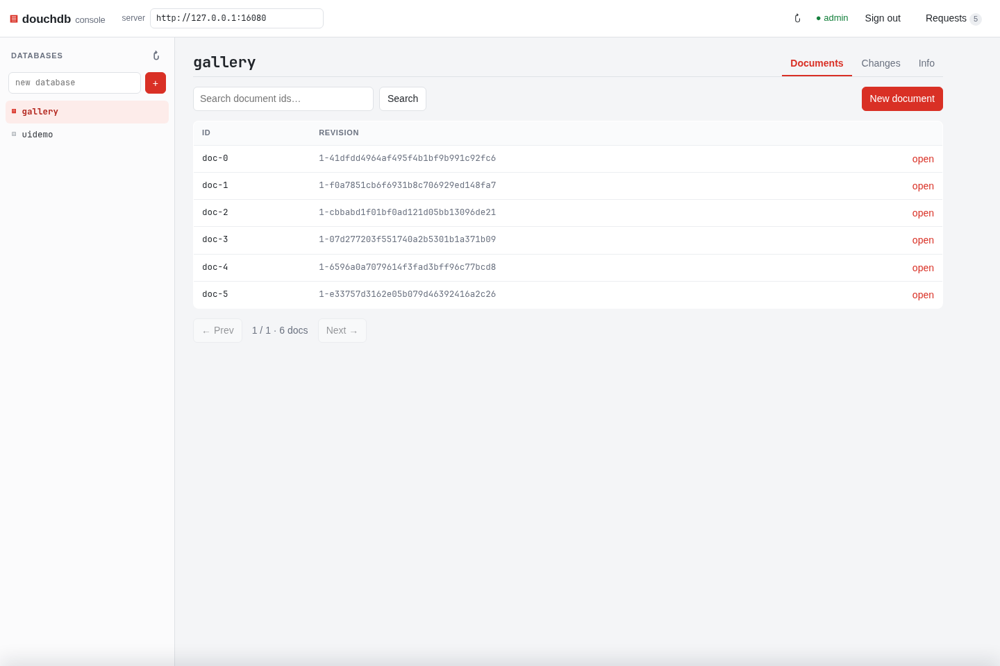

# douchdb

A small CouchDB **wire-compatible** document database in Rust, stored on
LevelDB, runnable as a Q-shard × N-replica cluster.

The goal is not to reimplement all of CouchDB. It is a server that PouchDB and
CouchDB can replicate against in both directions, with CouchDB-compatible
revision ids, HTTP shapes and status codes. No server-side JavaScript, views,
Mango or `_replicator`.

See [PLAN.md](PLAN.md) for the design, decisions and known limits.

## Quick start

```sh
cargo build --release
./target/release/douchdb
```

That listens on `127.0.0.1:5984` and stores data in `./data`. With no
`--admin`, authentication is disabled.

```sh
curl -X PUT localhost:5984/demo
curl -X PUT localhost:5984/demo/doc1 \
  -H 'Content-Type: application/json' \
  -d '{"hello":"world"}'
curl localhost:5984/demo/doc1
curl 'localhost:5984/demo/_all_docs?include_docs=true'
curl 'localhost:5984/demo/_changes'
```

PouchDB can replicate to and from it directly:

```js
const local = new PouchDB('local');
const remote = new PouchDB('http://localhost:5984/demo');
local.replicate.to(remote);
local.replicate.from(remote);
```

CouchDB can push a database into douchdb using CouchDB's own `_replicate`
(douchdb does not implement `_replicate` itself; clients drive replication):

```sh
# Run against the CouchDB node; `source` is a database on that node.
curl -X POST http://couch:5984/_replicate \
  -H 'Content-Type: application/json' \
  -d '{"source":"source","target":"http://douchdb:5984/demo"}'
```

## Web console

A Fauxton-style console is embedded at `http://localhost:5984/_utils/`:



It is a single Vue 3 application with a vendored runtime — **no npm and no build
step**. It provides:

- database list, create and delete;
- `_all_docs` browser with prefix search and pagination;
- document viewer/editor with JSON validation, revisions and delete;
- `_changes` feed with history and live follow;
- database info and `_compact`;
- CouchDB `_session` sign-in when the server runs with `--admin`;
- a toggleable **request log** that records every HTTP call with method, path,
  status, timing, request JSON and response JSON.

The console uses only the public CouchDB HTTP API. Its assets live in [`ui/`](ui)
and are compiled into the binary, so `cargo build` after editing them. If you
serve `ui/` from a different origin, set the server URL in the header and start
douchdb with `--cors-origins` for that origin (see below).

## Configuration

```
douchdb [--listen ADDR] [--data DIR] [--q N] [--n N] [--revs-limit N]
        [--admin user:pass] [--nodes URL,URL] [--me INDEX] [--sync-secs N]
        [--cors-origins ORIGIN,ORIGIN]
```

| Flag | Default | Meaning |
|---|---|---|
| `--listen` | `127.0.0.1:5984` | HTTP listen address |
| `--data` | `data` | Data directory (one LevelDB per database/shard) |
| `--q` | `1` | Shards per database, fixed at creation |
| `--n` | `2` | Replication factor, clamped to the node count |
| `--revs-limit` | `1000` | Revision history kept per document |
| `--admin` | none | `user:pass` for Basic auth and `_session` |
| `--nodes` | empty | Comma-separated base URLs of every node |
| `--me` | `0` | This node's index in `--nodes` |
| `--sync-secs` | `5` | Anti-entropy pull interval |
| `--cors-origins` | empty | Allowed browser origins; empty disables CORS |

Without `--nodes` it runs as a single node (the cluster with one member).

## CORS

Cross-origin access is **off by default**. Enable it for browser clients
(PouchDB in a web app, a separately hosted console) with an explicit list:

```sh
./target/release/douchdb --cors-origins 'http://localhost:5173,https://*.example.com'
```

`*` allows any origin. Origins are echoed back in
`Access-Control-Allow-Origin` rather than literally sending `*`, so
`Access-Control-Allow-Credentials: true` works with `_session` cookies. `OPTIONS`
preflights return `204` with the requested headers and a one-hour max-age;
preflights from origins not on the list return `403` and get no CORS headers.
Wildcards match subdomains (`https://*.example.com`), and ports must match
exactly.

`--cors-origins '*'` lets any website make credentialed requests against a
logged-in session, so prefer an explicit list outside local development. The
embedded `/_utils/` console is same-origin and needs no CORS flag.

## Cluster

Every node needs the same `--nodes`, `--q` and `--n`. Membership is static: to
change it, restart the cluster with the new list.

```sh
BIN=./target/release/douchdb
NODES=http://127.0.0.1:5984,http://127.0.0.1:5985,http://127.0.0.1:5986

$BIN --listen 127.0.0.1:5984 --data /tmp/n1 --q 4 --n 2 --nodes $NODES --me 0
$BIN --listen 127.0.0.1:5985 --data /tmp/n2 --q 4 --n 2 --nodes $NODES --me 1
$BIN --listen 127.0.0.1:5986 --data /tmp/n3 --q 4 --n 2 --nodes $NODES --me 2
```

Any node routes a request for a document to one of its replicas, so clients can
talk to any node. Database creation and deletion are broadcast. A document's
primary is the first replica; writes are copied to the rest of the set, and
`?w=` / `?r=` select write and read quorum (default: write quorum, single read).
An unmet write quorum returns `202` and anti-entropy repairs the replica.

`_changes` and `GET /db` use a base64url version vector for `since` /
`update_seq`, so a client that saw a partial fan-out resumes without skipping
changes.

## API surface

`GET /`, `_up`, `_all_dbs`, `_uuids`, `_membership`, `_session`, `_security`,
database create/get/delete, document CRUD with `?rev=`, `?revs=`,
`?open_revs=`, `?new_edits=false`, `_bulk_docs`, `_bulk_get`, `_all_docs`,
`_changes` (normal/longpoll/continuous, `style=all_docs`, `filter=_doc_ids`),
`_revs_diff`, `_local/*`, `_purge`, `_compact`, `_revs_limit`,
`_ensure_full_commit`, and base64 attachments.

## Tests

```sh
cargo test
```

This runs unit tests plus integration tests that start real server processes
and assert CouchDB wire shapes, revision ids, replication and cluster behaviour
(including killing a node mid-replication).

The 10 GB storage spike starts its own server and writes ~10 GB under
`target/spike-data`:

```sh
cargo build --release
python3 scripts/storage_spike.py --target-gb 10
```

It reports throughput, write/read latencies, compaction latency and
amplification, and checks durability across `kill -9`.

## Status and limits

v0.1: the replication protocol, attachments, auth, and a Q-shard × N-replica
cluster with anti-entropy are implemented and tested. Known limits:

- Static membership and no rebalancing beyond rendezvous hashing.
- Version vectors are keyed per node, not per shard replica.
- `_compact` runs synchronously in the shard actor: at 10 GB it blocks that
  shard for ~27 s (measured in [PLAN.md](PLAN.md)).
- No views, Mango, server-side JS, multipart attachments or metrics.
