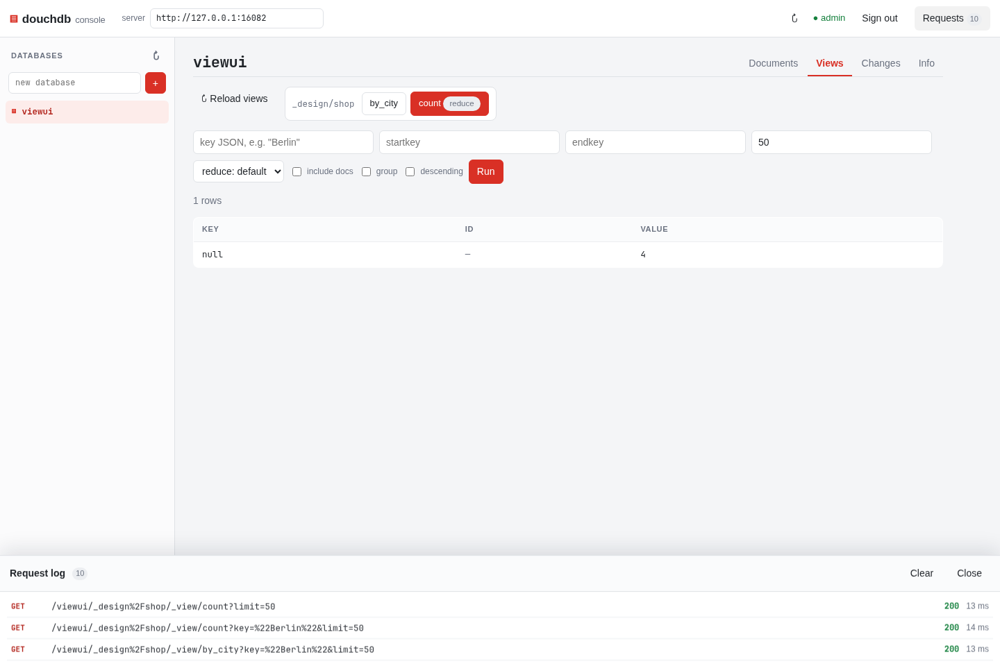
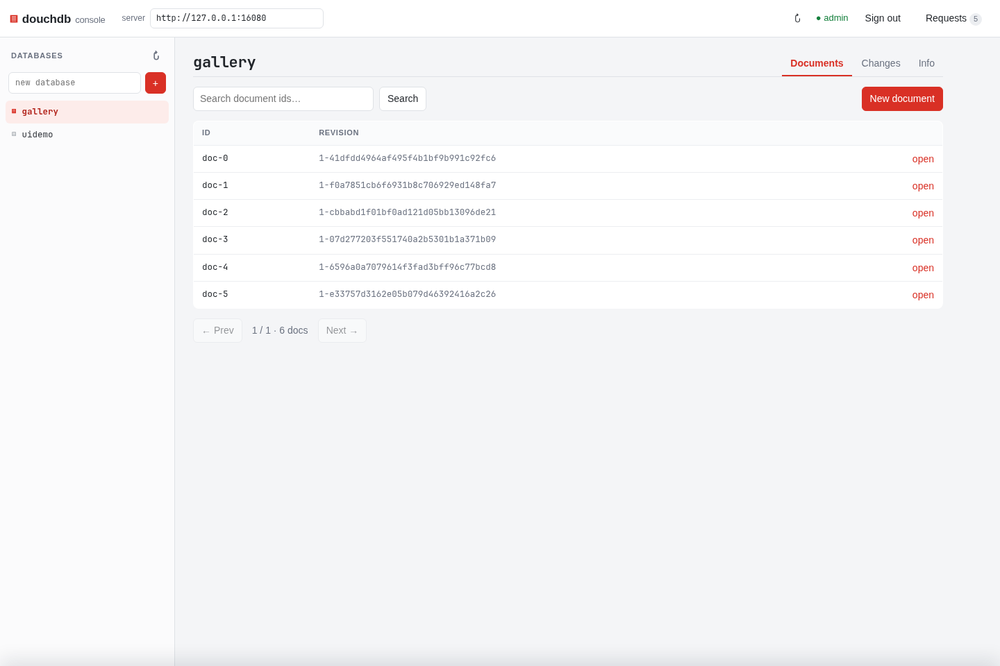

# douchdb

A small CouchDB **wire-compatible** document database in Rust, stored on
LevelDB, runnable as a Q-shard × N-replica cluster.

The goal is not to reimplement all of CouchDB. It is a server that PouchDB and
CouchDB can replicate against in both directions, with CouchDB-compatible
revision ids, HTTP shapes and status codes. Map/reduce views and search indexes
run on QuickJS — native, worker-process or WASM — and design-document JavaScript
gets no network or filesystem access. Mango, `_replicator`, lists and shows are
not implemented.

See [PLAN.md](PLAN.md) for the design, decisions and known limits.

## Quick start

```sh
cargo build --release
./target/release/douchdb
```

That listens on `127.0.0.1:5984` and stores data in `./data`. With no
`--admin`, authentication is disabled.

```sh
curl -X PUT localhost:5984/demo
curl -X PUT localhost:5984/demo/doc1 \
  -H 'Content-Type: application/json' \
  -d '{"hello":"world"}'
curl localhost:5984/demo/doc1
curl 'localhost:5984/demo/_all_docs?include_docs=true'
curl 'localhost:5984/demo/_changes'
```

PouchDB can replicate to and from it directly:

```js
const local = new PouchDB('local');
const remote = new PouchDB('http://localhost:5984/demo');
local.replicate.to(remote);
local.replicate.from(remote);
```

CouchDB can push a database into douchdb using CouchDB's own `_replicate`
(douchdb does not implement `_replicate` itself; clients drive replication):

```sh
# Run against the CouchDB node; `source` is a database on that node.
curl -X POST http://couch:5984/_replicate \
  -H 'Content-Type: application/json' \
  -d '{"source":"source","target":"http://douchdb:5984/demo"}'
```

## Docker Compose

A three-node cluster, console and Grafana OpenTelemetry stack are provided:

Set the required secrets first (there are no defaults; `docs/docker.md` has a
generator for a git-ignored `.env`), then:

```sh
docker compose up --build -d
```

All ports are bound to `127.0.0.1`.

- API + console: http://localhost:8080 — nginx round-robins across all nodes; login with the `DOUCHDB_ADMIN` credentials from `.env`
- Direct nodes: ports 5984, 5985 and 5986
- Grafana: http://localhost:3000 (login `admin` / `GRAFANA_ADMIN_PASSWORD`)
- OTLP/HTTP: http://localhost:4318

The cluster uses `q=4`, `n=3`, three data volumes and OTLP export to Grafana's
`otel-lgtm` all-in-one backend. See [docs/docker.md](docs/docker.md) for the
service layout, credentials, verification commands and teardown. The stack is
for local development: it has no TLS.

## Partitioned databases

See [docs/partitioned-databases.md](docs/partitioned-databases.md) for the full
guide, including cluster behavior, view rules and limits.

Create a CouchDB-style partitioned database with:

```sh
curl -X PUT 'localhost:5984/sensors?partitioned=true'
```

Every document id, except design documents, must be `partition:docid`. The
partition is everything before the first colon; the document id may contain
more colons. Partitioned databases hash by the partition key, so every document
in a partition lives on the same shard and its replicas.

```sh
curl -X POST localhost:5984/sensors/_bulk_docs \
  -H 'Content-Type: application/json' \
  -d '{"docs":[
        {"_id":"field-1:reading-1","value":0.15},
        {"_id":"field-1:reading-2","value":0.14},
        {"_id":"field-2:reading-1","value":0.22}
      ]}'
```

Partition-scoped endpoints:

```sh
curl localhost:5984/sensors/_partition/field-1
curl localhost:5984/sensors/_partition/field-1/_all_docs
curl localhost:5984/sensors/_partition/field-1/_design/readings/_view/by_time
```

Design documents in a partitioned database are partitioned by default and are
queried through `_partition/{partition}`. Add `"options": {"partitioned":
false}` to a design document to make its views global; global views are queried
through the normal `/{db}/_design/{ddoc}/_view/{view}` path. Global `_all_docs`
queries across partitions remain available.

## Views

Views live in design documents and run JavaScript map/reduce functions on the
embedded QuickJS engine. Start with a small database:

```sh
curl -X PUT localhost:5984/shop
curl -X POST localhost:5984/shop/_bulk_docs \
  -H 'Content-Type: application/json' \
  -d '{"docs":[
        {"_id":"a","city":"Berlin","tags":["book"],"price":10},
        {"_id":"b","city":"Berlin","tags":["book","sale"],"price":20},
        {"_id":"c","city":"Paris","tags":["music"],"price":5},
        {"_id":"d","city":"Paris","tags":["book"],"price":15}
      ]}'
```

### Map

A map function receives each document and calls `emit(key, value)` zero or
more times. The index is sorted by key, then by document id:

```js
function (doc) {
  if (doc.city) emit(doc.city, doc.price);
}
```

The same function embedded in a design document:

```sh
curl -X PUT localhost:5984/shop/_design/shop \
  -H 'Content-Type: application/json' \
  -d @- <<'JSON'
{
  "views": {
    "by_city": {
      "map": "function (doc) { if (doc.city) emit(doc.city, doc.price); }"
    },
    "totals": {
      "map": "function (doc) { if (doc.city) emit(doc.city, doc.price); }",
      "reduce": "_sum"
    },
    "count": {
      "map": "function (doc) { if (doc.city) emit(doc.city, null); }",
      "reduce": "_count"
    },
    "average": {
      "map": "function (doc) { if (doc.city) emit(doc.city, doc.price); }",
      "reduce": "function (keys, values, rereduce) { if (rereduce) { var sum = 0; var count = 0; for (var i = 0; i < values.length; i++) { sum += values[i].sum; count += values[i].count; } return { sum: sum, count: count, mean: count ? sum / count : 0 }; } var sum = 0; for (var i = 0; i < values.length; i++) sum += values[i]; return { sum: sum, count: values.length, mean: values.length ? sum / values.length : 0 }; }"
    },
    "tags": {
      "map": "function (doc) { (doc.tags || []).forEach(function (tag) { emit([doc.city, tag], 1); }); }",
      "reduce": "_count"
    }
  }
}
JSON

curl 'localhost:5984/shop/_design/shop/_view/by_city'
```

```json
{
  "total_rows": 4,
  "offset": 0,
  "rows": [
    {"id": "a", "key": "Berlin", "value": 10},
    {"id": "b", "key": "Berlin", "value": 20},
    {"id": "c", "key": "Paris",  "value": 5},
    {"id": "d", "key": "Paris",  "value": 15}
  ]
}
```

The `tags` view emits once per tag, so one document can produce several rows.

### Native fast path for simple maps

A deliberately narrow map shape bypasses JavaScript entirely:

```js
function(doc){ emit(doc.field); }
function(doc){ emit(doc.field, doc.other); }
function(doc){ emit(doc.field, 1); }
function(doc){ emit(doc["field"], "constant"); }
```

Arrow forms such as `(doc) => { emit(doc.city, 1); }` are also recognized.
Everything else - conditions, multiple emits, loops, local variables, custom
objects - falls back to QuickJS.

This is an intentional departure from CouchDB's "always run JavaScript"
model for these simple views. The emitted JSON is the same for normal
document fields: missing fields become `null`, and the second argument
defaults to `null`. Native extraction does not perform JavaScript number
coercion and does not expose `Object.prototype` properties.

The view index records that the native path was used, so an already-built
JavaScript index is rebuilt once when a view becomes eligible.
Map queries support `key`, `keys` (GET or POST body), `startkey`, `endkey`,
`startkey_docid`, `endkey_docid`, `descending`, `inclusive_end`, `skip`,
`limit` and `include_docs`.

### Reduce

Add `reduce` to a view to collapse its rows. Built-ins are `_count`, `_sum`,
`_stats` and `_approx_count_distinct`; `group=true` reduces per key and
`group_level=N` groups array keys by their first N elements.

The built-in reducers run entirely in Rust. `_count`, `_sum` and `_stats` are
also combined natively on the coordinator in a cluster; custom JavaScript
reducers are the only reduce path that uses QuickJS, including their
`rereduce=true` pass. `_approx_count_distinct` counts distinct emitted keys
with CouchDB's HyperLogLog (precision 11, SHA-1 of the key's
`term_to_binary`), so it returns CouchDB's estimates, not exact counts; its
sketches union exactly across blocks, shards and nodes.

```sh
curl 'localhost:5984/shop/_design/shop/_view/totals?group=true'
```

```json
{
  "rows": [
    {"key": "Berlin", "value": 30},
    {"key": "Paris",  "value": 20}
  ]
}
```

Use `reduce=false` to see the underlying map rows even on a reduce view, and
`group_level=1` on `tags` to count tags per city:

```sh
curl 'localhost:5984/shop/_design/shop/_view/tags?group_level=1'
# {"rows":[{"key":["Berlin"],"value":3},{"key":["Paris"],"value":2}]}
```

The response shape for map queries is
`{"total_rows","offset","rows":[{"id","key","value"}]}`; reduce queries return
`{"rows":[{"key","value"}]}`.

### Re-reduce

A group can be much larger than the 1000 rows the runtime reduces at a time.
The reduce function is first called for each batch with `rereduce=false` and
`values` holding the emitted values. The partial results are then passed to the
same function with `rereduce=true`, `keys=null`, and `values` holding the
partial results. The `average` view above handles both calls:

```js
function (keys, values, rereduce) {
  var sum = 0;
  var count = 0;
  if (rereduce) {
    // values are results from earlier reduce calls
    for (var i = 0; i < values.length; i++) {
      sum += values[i].sum;
      count += values[i].count;
    }
  } else {
    // values are the numbers emitted by the map function
    for (var i = 0; i < values.length; i++) {
      sum += values[i];
      count += 1;
    }
  }
  return { sum: sum, count: count, mean: count ? sum / count : 0 };
}
```

```sh
curl 'localhost:5984/shop/_design/shop/_view/average?group=true'
```

```json
{
  "rows": [
    {"key": "Berlin", "value": {"sum": 30, "count": 2, "mean": 15}},
    {"key": "Paris",  "value": {"sum": 20, "count": 2, "mean": 10}}
  ]
}
```

With these four documents the group is small, so only the `rereduce=false`
branch runs. Add more than 1000 rows with the same key to exercise the
`rereduce=true` branch; the result is the same. Built-in `_stats` is already
rereduce-safe.

The console follows Fauxton's design-document workflow: **Design Docs** lists
design documents, opening one shows its views, and a view page deep-links the
selected view, edits map/reduce source in a CodeMirror editor, creates or
deletes views, and runs queries with the same options. New views start from a
small template (all documents, count by type, sum by type, or blank).



Views are indexed persistently and incrementally. Each database keeps its
indexes under `_view_indexes/`; a query applies `_changes` since the last
indexed sequence and only re-runs the map function for changed documents. A
design-document change (or a database reset) rebuilds that view. Deleting a
database removes its indexes. Design documents are replicated to every node so
each node can map its local shards.

Behaviour and limits:

- Only the winning revision of each document is mapped; `_design/` and
  `_local/` documents are skipped.
- String keys use ICU's default collation (ICU4X), matching CouchDB's
  locale-aware ordering; arrays and objects use CouchDB's JSON type order.
- Map/reduce functions default to a 64 MiB heap, a 512 KiB stack and a 5 s
  wall-clock limit per query; change the heap and timeout with
  `--view-memory-mb` and `--view-timeout-ms`.
- JavaScript runs in QuickJS. The default is in-process with heap, stack and
  wall-clock limits; `--js-sandbox process` uses a warmed worker pool with a
  cleared environment, `/` cwd, rlimits, a seccomp allowlist, a best-effort
  Landlock filesystem layer and a kill watchdog; `--js-sandbox wasm` runs the
  checked-in QuickJS WASM runner with linear-memory limits under `wasmi`
  (default) or the optional `wasmtime` Cranelift JIT. wasmtime is 4–7× faster
  for cold map/reduce work; build with `--features wasmtime` and select it with
  `--wasm-runtime wasmtime`. The wasm sandbox is the default-on `wasm` cargo
  feature; `--no-default-features` drops it (and wasmi's dependency tree), and
  `--js-sandbox wasm` then fails at startup. See
  [docs/quickjs-sandbox.md](docs/quickjs-sandbox.md).
- Large groups are reduced in batches of 1000 and the partial results are
  rereduced with `rereduce=true`.
- On a cluster, the coordinator fetches map rows from every node and merges
  them, so views span all shards. If any node cannot answer (unreachable,
  missing database or view), the query fails rather than silently returning
  partial rows.

## Changes feeds

`GET /{db}/_changes` has four feed formats. All of them accept `since` (`0`,
`now`, or an opaque cluster version vector), `limit`, `include_docs`,
`style=all_docs` and `filter=_doc_ids`. Longpoll, continuous and eventsource
also accept `heartbeat` and `timeout` in milliseconds, capped at five minutes.

**`feed=normal`** (default) returns one JSON object:

```json
{"results": [...], "last_seq": 42, "pending": 0}
```

**`feed=longpoll`** holds the request until changes appear or the timeout
expires, then returns the same JSON object. With `heartbeat`, newline
keepalives are sent while waiting.

**`feed=continuous`** returns a chunked `application/json` stream with one
change object per line. Blank lines are heartbeats.

```sh
curl -N 'localhost:5984/db/_changes?feed=continuous&since=now&heartbeat=10000'
```

**`feed=eventsource`** returns a Server-Sent Events stream,
`Content-Type: text/event-stream`, with each event framed as:

```text
data: {"seq":42,"id":"doc1","changes":[{"rev":"1-..."}]}

```

Heartbeats are SSE comments (`: heartbeat`). In a browser:

```js
const changes = new EventSource(
  'http://localhost:5984/db/_changes?feed=eventsource&since=0&heartbeat=10000'
);
changes.onmessage = (event) => {
  const change = JSON.parse(event.data);
  console.log(change.id, change.seq);
};
```

`EventSource` cannot set an `Authorization` header: use a same-origin
`_session` cookie, or put a proxy in front. The eventsource feed does not
implement `Last-Event-ID` resume; reconnect with an explicit `since` value
(the previous `last_seq` or change `seq`).

`_db_updates` also supports `feed=normal`, `longpoll` and `continuous`, but not
the eventsource format. On a cluster, `since` and `last_seq` are opaque
`v1:` comma-separated version vectors (the decoder still accepts legacy
base64url tokens); treat them as opaque and do not parse them client-side.

## Web console

A Fauxton-style console is embedded at `http://localhost:5984/_utils/`:



It is a single Vue 3 application with a vendored runtime — **no npm and no build
step**. It provides:

- database list, create and delete, refreshed on focus and every 15 seconds
  so databases created with `curl` appear without a manual reload; sign-in
  guidance when the server requires authentication;
- `_all_docs` browser with prefix search and pagination;
- Fauxton-style document browsing: open any document by id with its own
  deep-link, edit JSON, save, create and delete, with revision conflict
  reporting;
- `_changes` feed with history and live follow;
- database info and `_compact`;
- a cluster page with node discovery, shard maps, background replication
  status, and controls to discover, sync, pause/resume and rebalance;
- an observability page with live request/latency/error sparklines, route and
  database tables, replication and fabric counters, per-node health and cluster
  aggregation;
- an Access page listing each visible database's `_security` members/admins,
  with an editor for names and roles;
- CouchDB `_session` sign-in when the server runs with `--admin`;
- a toggleable **request log** that records every HTTP call with method, path,
  status, timing, request JSON and response JSON.

The console uses only the public CouchDB HTTP API. Its assets live in [`ui/`](ui)
and are compiled into the binary, so `cargo build` after editing them. If you
serve `ui/` from a different origin, set the server URL in the header and start
douchdb with `--cors-origins` for that origin (see below).

## Configuration

```
douchdb [--listen ADDR] [--data DIR] [--q N] [--n N] [--revs-limit N]
        [--admin user:pass]         (or DOUCHDB_ADMIN)
        [--users-file FILE] [--session-secret SECRET]
        [--default-security open|admin-only]
        [--max-in-flight N] [--per-user-in-flight N] [--per-user-rate N]
        [--heavy-in-flight N] [--heavy-per-user N] [--background-in-flight N]
        [--compact-concurrency N]
        [--nodes URL,URL] [--me INDEX] [--sync-secs N]
        [--advertise URL] [--seed-nodes URL,URL]
        [--js-sandbox native|process|wasm] [--wasm-runtime wasmi|wasmtime]
        [--js-workers N]
        [--cluster-secret SECRET] [--cors-origins ORIGIN,ORIGIN]
        [--cors-credentials] [--cors-headers HEADER,HEADER]
        [--cors-methods METHOD,METHOD] [--cors-exposed-headers HEADER,HEADER]
        [--cors-max-age SECS]
        [--view-timeout-ms N] [--view-memory-mb N] [--max-request-mb N]
        [--max-open-indexes N] [--max-open-dbs N]
        [--rebalance-write-drain-ms N] [--rebalance-stable-wait-ms N]
        [--rebalance-freeze-ms N] [--js-worker-startup-ms N]
        [--otel-endpoint URL]
```

| Flag | Default | Meaning |
|---|---|---|
| `--listen` | `127.0.0.1:5984` | HTTP listen address |
| `--data` | `data` | Data directory (one LevelDB per database/shard) |
| `--q` | `2` | Default shards per database, fixed at creation (CouchDB's default) |
| `--n` | `3` | Default copies of each shard, clamped to the node count (CouchDB's default) |
| `--revs-limit` | `1000` | Revision history kept per document |
| `--admin` | none | Server-admin `user:pass` for Basic auth and `_session` (or `DOUCHDB_ADMIN`, which keeps the password out of the process list) |
| `--users-file` | none | JSON users file with token/roles entries (see [docs/multiuser.md](docs/multiuser.md)) |
| `--session-secret` | random, kept in `<data>/.session-secret` | HMAC key for `AuthSession` cookies (or `DOUCHDB_SESSION_SECRET`); set the same value on every node for cross-node sessions |
| `--default-security` | `admin-only` when auth is configured | Empty `_security` databases are `admin-only` or `open` |
| `--max-in-flight` | `64` | Global concurrent HTTP requests |
| `--per-user-in-flight` | `16` | Concurrent requests per principal |
| `--per-user-rate` | `0` | Requests/second per principal; `0` unlimited |
| `--heavy-in-flight` | `8` | Global concurrent view/search requests |
| `--heavy-per-user` | `1` | Concurrent view/search requests per principal |
| `--background-in-flight` | `2` | Concurrent anti-entropy/discovery passes |
| `--compact-concurrency` | `1` | Concurrent `_compact` requests across databases on this node |
| `--nodes` | empty | Comma-separated base URLs of every node |
| `--me` | `0` | This node's index in `--nodes` |
| `--sync-secs` | `5` | Anti-entropy pull and discovery interval |
| `--advertise` | matching `--nodes` entry | URL shown for this node in cluster views |
| `--seed-nodes` | empty | Extra peers probed for membership discovery |
| `--js-sandbox` | `native` | `native` runs QuickJS in-process; `process` uses a warmed worker pool; `wasm` runs the checked-in WASM QuickJS runner |
| `--wasm-runtime` | `wasmi` | WASM host runtime: `wasmi` (lean interpreter) or `wasmtime` (Cranelift JIT; build with `--features wasmtime`, which needs Rust 1.97+) |
| `--js-workers` | `2` | Worker processes when `--js-sandbox process` is enabled |
| `--cluster-secret` | empty | Shared secret for internal requests; required with more than one node (or use `DOUCHDB_CLUSTER_SECRET`) |
| `--peer-http2` | off | Send node-to-node requests over HTTP/2 (see [Node-to-node transport](#node-to-node-transport)) |
| `--cors-origins` | empty | Allowed browser origins; empty disables CORS |
| `--cors-credentials` | off | Send `Access-Control-Allow-Credentials: true`, so cross-origin pages may use cookies and `Authorization` (CouchDB `[cors] credentials`, default false) |
| `--cors-headers` | empty | Request headers a preflight may ask for; replaces CouchDB's default list (CouchDB `[cors] headers`) |
| `--cors-methods` | CouchDB's list | Methods a preflight may ask for and `Access-Control-Allow-Methods` lists; replaces CouchDB's default list (CouchDB `[cors] methods`, matched case-sensitively) |
| `--cors-exposed-headers` | CouchDB's list | Response headers named in `Access-Control-Expose-Headers` after `content-type` and the simple headers present; replaces CouchDB's list (CouchDB `[cors] exposed_headers`) |
| `--cors-max-age` | 600 | `Access-Control-Max-Age` seconds on a preflight (CouchDB `[cors] max_age`) |
| `--view-timeout-ms` | `5000` | Wall-clock limit for one view query. Matches CouchDB's `[couchdb] os_process_timeout` (5000 ms). Slow or heavily loaded hosts may need a larger value |
| `--view-memory-mb` | `64` | QuickJS heap limit for native/process modes; wasm uses a 128 MiB linear-memory cap |
| `--max-request-mb` | `64` | Maximum HTTP request body |
| `--rebalance-write-drain-ms` | `15000` | How long a rebalance waits, once writes are frozen, for in-flight writes to finish (on the coordinator and on each peer). Slow or heavily loaded hosts may need a larger value |
| `--rebalance-stable-wait-ms` | `10000` | How long a rebalance waits for the frozen old replicas to agree on one content digest per shard. Slow or heavily loaded hosts may need a larger value |
| `--rebalance-freeze-ms` | `420000` | Upper bound on a rebalance write freeze; if the coordinator disappears, writes resume after this long. It also bounds the whole rebalance, so a slow or heavily loaded cluster may need a larger value. Set it the same on every node: each node applies its own value to the freeze it accepts from a peer |
| `--js-worker-startup-ms` | `10000` | How long a `--js-sandbox process` worker may take to start before it is killed. Slow or heavily loaded hosts may need a larger value |
| `--max-open-dbs` | `256` | Most databases kept open between requests (CouchDB's `max_dbs_open` is 500, but a database here costs a thread and several file descriptors per shard). Past it the least recently used database that no request is using, and that is not rebalancing or compacting, is closed and reopened from disk on its next request. Each open database holds one actor thread and store per shard (`q`), so size this with `q` and the file descriptor limit in mind. |
| `--max-open-indexes` | `256` | Most view indexes, and most search indexes, kept open between queries. Past it the least recently used index that no query is using is closed and reopened from disk on its next query. CouchDB keeps an index process per active view with no such cap; this bounds memory and file descriptors on nodes with many databases. |
| `--otel-endpoint` | env | OTLP HTTP base endpoint; `/v1/traces` and `/v1/metrics` are appended |

Without `--nodes` it runs as a single node (the cluster with one member).

Exit status: `0` after a clean shutdown (SIGTERM or SIGINT), `2` for a
configuration the server refuses to start with (an unparsable flag, a bad
`--users-file` or `--admin`, a cluster without `--cluster-secret`), and `1` for
a runtime failure such as being unable to bind the listen address.

## CORS

Cross-origin access is **off by default**. Enable it for browser clients
(PouchDB in a web app, a separately hosted console) with an explicit list:

```sh
./target/release/douchdb --cors-origins 'http://localhost:5173,https://*.example.com'
```

`*` allows any origin. As in CouchDB, `Access-Control-Allow-Origin` always
carries the request's own origin, also for `*`. Credentials are off, as in
CouchDB's `[cors] credentials = false`: add `--cors-credentials` to send
`Access-Control-Allow-Credentials: true`, which a browser PouchDB needs (it
sends requests with credentials). Preflights follow CouchDB's `chttpd_cors`: a
preflight whose method and requested headers are supported gets `204` with
`Access-Control-Max-Age: 600`, CouchDB's full method list and the requested
headers echoed back. The supported request headers are CouchDB's default list
(`Accept`, `Authorization`, `Content-Type`, `Origin` and so on), or exactly
the headers given in `--cors-headers` (CouchDB `[cors] headers` replaces the
default list). `--cors-methods` likewise replaces the supported (and
advertised) method list, `--cors-exposed-headers` replaces the response headers
CouchDB always exposes (`accept-ranges`, `etag`, `server`, `x-couch-request-id`
and so on) and `--cors-max-age` replaces the 600 s default. Per-host
`[cors:host]` sections have no equivalent: the options are global. JSON
responses carry `Cache-Control: must-revalidate` as in CouchDB, so it is named
in `Access-Control-Expose-Headers`. Anything else, including a header outside that list, is not
treated as a preflight: it gets no preflight headers and is handled as a
plain `OPTIONS` request, so the browser rejects it. Wildcards match
subdomains (`https://*.example.com`, a douchdb extension), and ports must
match exactly.

`--cors-origins '*' --cors-credentials` lets any website make credentialed
requests against a logged-in session, so prefer an explicit list outside local
development. The
embedded `/_utils/` console is same-origin and needs no CORS flag.

## Cluster

douchdb runs as a static **Q-shard × N-replica** cluster. Every node is a
router; there is no coordinator role.

- A database's shard count and copy count are fixed when it is created:
  `PUT /db?q=8&n=2` as in CouchDB, otherwise `--q` and `--n`. `GET /db`
  reports them in `cluster`, with the default write and read quorums
  (`n/2 + 1`) that writes and reads to that database use.
- `md5(docid)` selects the shard; rendezvous hashing over the node list selects
  `--n` distinct replicas, in preference order. The first is the primary.
- A write is sent to every replica in the shard set and returns once the
  requested quorum acknowledges; the remaining writes continue detached. Reads
  fan out to the replica set and enforce the requested read quorum; `?r=1` is the
  local fast path when a replica is unavailable.
- Numeric `_changes` cursors are watermarked across shards: a cursor is not
  advanced past a sequence that another shard has allocated but not yet
  committed. Overlapping writes can therefore cause a short re-read, but not a
  skipped document. Cluster feeds keep their opaque version-vector cursor.
- `?w=` / `?r=` select write and read quorum. The default read quorum is
  `r = (n/2)+1`; `?r=1` is the local fast path. A read that reaches fewer than
  `r` replicas returns `503 quorum_not_met`, a deliberate departure from
  CouchDB's `fabric_doc_open`, which serves the best document it received.
  When no replica answers, the errors are CouchDB's: `500 read_failure` for a
  plain or `revs_info` read, `503 service unavailable` for `open_revs` or an
  explicit `rev`. Replica answers are merged, tombstones and all conflict
  leaves included. Ancestry is merged from every replica before leaf bodies
  are deduplicated, so a longer history on one node is not lost; requested
  histories return the longest retained path deterministically. Revision-shaped
  reads (`open_revs`, `revs_info=true`) still require `r` reachable replicas,
  but return the local response shape.
  An unmet write quorum returns `202`; anti-entropy repairs the replica later.
- Anti-entropy runs every `--sync-secs`, pulling from every peer for the shards
  the node replicates plus every design document, so a returning node can
  evaluate its local views. It uses the shared admin credentials when
  `--admin` is set; a client's Basic auth or `_session` cookie is forwarded on
  internal calls. This is non-client-induced replication: it catches up after
  missed writes, restarts and offline periods without a client request.
- `validate_doc_update` functions come from the coordinating node's own design
  documents (cached, dropped on any design-document write), so a write makes no
  peer call to find validators, with or without a peer down. Design documents
  are written to every node; a node that missed such a write (it was down)
  enforces the validator once anti-entropy has pulled the document: at startup
  and then at most one `--sync-secs` interval (plus the pass itself) after a
  peer holding it is reachable. Until then writes it coordinates are not
  checked by that validator. A corrupt or unreadable local design document
  fails writes rather than being skipped.
- Cluster management is exposed at `/_node/_local/_cluster`,
  `/_node/_local/_replication` and in the console. Discovery probes configured
  nodes, `--seed-nodes` and the memberships they report, marking reachable
  peers that are not in the placement list. Placement itself is still static.
  See [docs/cluster-management.md](docs/cluster-management.md).
- Design documents (`_design/...`) are replicated to every node, because each
  node needs them to evaluate views over its local shards.
- Database creation and deletion are broadcast to all configured nodes; design
  documents are replicated to every node so views can run against any shard.
- `_changes` and `GET /db` return a `v1:` comma-separated version vector for
  `since` / `update_seq` (legacy base64url tokens are still accepted), so a
  client that saw a partial fan-out resumes without skipping changes.

All nodes must use identical `--nodes`, `--q`, `--n`, `--cluster-secret` and
`--admin` credentials. The cluster secret authenticates internal routing headers,
so a client cannot make a request look like a peer's. It is required (at least
16 characters) when `--nodes` lists more than one node:

```sh
BIN=./target/release/douchdb
NODES=http://127.0.0.1:5984,http://127.0.0.1:5985,http://127.0.0.1:5986

# Environment variables keep the credentials out of the process list.
export DOUCHDB_ADMIN=admin:$(openssl rand -hex 16)
SECRET=$(openssl rand -hex 16)
$BIN --listen 127.0.0.1:5984 --data /tmp/n1 --q 4 --n 3 \
  --cluster-secret $SECRET --nodes $NODES --me 0
$BIN --listen 127.0.0.1:5985 --data /tmp/n2 --q 4 --n 3 \
  --cluster-secret $SECRET --nodes $NODES --me 1
$BIN --listen 127.0.0.1:5986 --data /tmp/n3 --q 4 --n 3 \
  --cluster-secret $SECRET --nodes $NODES --me 2
```

Clients can talk to any node. Create the database through any node (it is
broadcast) and then write normally.

### Node-to-node transport

Every node's listener accepts HTTP/1.1 and cleartext HTTP/2 (h2c, prior
knowledge) on the same port, so clients see no difference. With
`--peer-http2` a node sends its requests to other nodes over HTTP/2: one
multiplexed, header-compressed connection per peer instead of one HTTP/1.1
connection per request in flight (to `https://` peers h2 is negotiated by ALPN
instead). Flow control is sized so a large `_bulk_docs` or `_changes` body
does not stall small requests on the same connection: 1 MiB per stream, 8 MiB
per connection, 64 KiB frames, 256 concurrent streams per connection, and a
keep-alive ping every 30 s (dead peer after 10 s). The 2 s connect and 60 s
request timeouts are unchanged.

The flag is **off by default** so a rolling upgrade is safe: a node that has
`--peer-http2` cannot talk to a peer from before this release, whose listener
is HTTP/1.1 only (the request fails like an unreachable peer; there is no
automatic fallback). Upgrade every node to this release first, still without
the flag, then restart them with `--peer-http2` one at a time; nodes with and
without the flag work together in any mix, because every upgraded listener
accepts both protocols. Once all nodes are upgraded, `--peer-http2` can be
enabled everywhere. A node reports how many requests from other nodes it
served per protocol under `http.internal_requests` in
`/_node/_local/_metrics`.

### Cluster limits

- **Static membership.** There is no gossip or automatic join. Discovery
  reports peers and drift, but it does not change placement. To change the
  node list, restart every node with the new list. Rendezvous hashing and
  anti-entropy copy data to new replicas; `rebalance` verifies
  revision-metadata digests before activation, and destructive cleanup requires
  `?cleanup=true`.
- **AP by default, but not unconditionally available.** Concurrent writes
  converge through CouchDB revision trees; there is no Raft and no global
  ordering beyond version vectors. A default quorum read can return `503` during
  a partition; `?r=1` is the explicit local-availability trade-off.
- **Best-effort database lifecycle.** A node that is offline during a database
  create or drop is not repaired automatically.
- **Node-local operations.** `_purge`, `_compact` and `_revs_limit` act only on
  the node that receives them.
- **Per-node version vectors.** `since` is keyed by node, not by shard replica;
  resumption is still exact, but the vector is coarser than CouchDB's.
- **No inter-node TLS or service accounts.** Nodes trust each other on the
  network; use a private network or a proxy if that matters.
- **Rebalance is not consensus.** `POST /_node/_local/_dbs/{db}/rebalance`
  uses a two-phase migration map: reads stay on the old owners, client writes
  are briefly frozen on every node, anti-entropy seeds the targets, and the
  active map switches only after revision-metadata digests match. Timeout
  leaves the old map active; cleanup is explicit. A direct placement `PUT` and
  cleanup return `409 rebalance_in_progress` while a migration owns the
  database. It is still an operator action built on static membership, not an
  online membership protocol.

The cluster paths are covered by the integration tests, including
`cluster_writes_land_on_the_whole_replica_set`,
`cluster_survives_killing_a_node_mid_replication`,
`authenticated_cluster_anti_entropy_converges`,
`cluster_serves_session_cookie_clients`,
`cluster_management_reports_discovery_and_runs_replication` and
`discovery_follows_seed_membership`.

## API surface

`GET /`, `_up`, `_all_dbs` (with `startkey`/`endkey`/`limit`/`skip`/
`descending`), `_db_updates` (normal/longpoll/continuous, heartbeat),
`_dbs_info`, `_uuids`, `_membership`, `_session`, `_security`, database
create/get/delete, document CRUD with `?rev=`, `?revs=`, `?open_revs=`,
`?new_edits=false`, `COPY`, `_bulk_docs`, `_bulk_get`, `_all_docs`,
`_design_docs`, `_local_docs`, `_changes` (normal/longpoll/true continuous, `feed=eventsource` SSE, heartbeat,
`style=all_docs`, `filter=_doc_ids`), `_revs_diff`, `_local/*`, `_purge`,
`_compact`,
`_revs_limit`, `_design/{ddoc}/_view/{view}`, `_view_cleanup` and
`_ensure_full_commit`. Observability endpoints: `_health`,
`_node/_local/_health`, `_node/_local/_metrics` and their `?cluster=true`
cluster-wide variants.

HTTP niceties: `If-Match` on writes, `If-None-Match`/304 on reads, `COPY` with
`Destination`, `HEAD` without a body, gzip responses, and
`X-Couch-Request-ID` on every response.

## Observability

Metrics and health are collected in-process and work without any collector.
The console page at `/_utils/#/metrics` shows them live; the same data is
available as JSON:

```sh
curl localhost:5984/_health                          # unauthenticated probe
curl localhost:5984/_node/_local/_health            # detailed checks
curl localhost:5984/_node/_local/_metrics           # process-local metrics
curl 'localhost:5984/_node/_local/_metrics?cluster=true'  # merged across peers
curl 'localhost:5984/_node/_local/_health?cluster=true'   # worst node health
```

The local metrics include HTTP counters, per-route p50/p95/p99 latency, a
120-second live history, view/search query latency, fabric read/quorum/fan-out
counters, shard-map and rebalance state, per-database and per-shard storage,
process RSS/threads/uptime, and the replication/discovery snapshots. Route
labels are templates, so document ids never become metric cardinality.

`?cluster=true` fans out to every configured peer, sums counters, merges latency
buckets before recomputing percentiles, aggregates per-shard document counts and
reports unreachable nodes as degraded health.

OpenTelemetry export is optional and additive. Set an OTLP HTTP endpoint:

```sh
./target/release/douchdb --otel-endpoint http://127.0.0.1:4318
# or
OTEL_EXPORTER_OTLP_ENDPOINT=http://127.0.0.1:4318 ./target/release/douchdb
```

Every HTTP request produces an OTLP trace span (`http.request`), the
`http.server.requests` and `http.server.duration.ms` metrics, plus fabric
counters. Logs remain on the normal formatting subscriber. Without an endpoint
the telemetry layer is a no-op, so the single-binary deployment has no collector
dependency. See [docs/opentelemetry.md](docs/opentelemetry.md) for endpoint
shapes, the local capture demo, signal names, cluster notes and health
semantics.

See [docs/process.md](docs/process.md) for the issue/branch workflow used for
this work.

## Multiuser and fairness

Authentication and authorization are deliberately small: a deployment-owned
JSON users file supplies tokens and roles, and each database has a CouchDB-shaped
`_security` object with `admins`/`members` names and roles. There is no `_users`
database, IAM integration, or row-level security.

```json
{"users":[
  {"name":"alice","token_sha256":"<sha256 of the bearer token>","roles":["analyst"]},
  {"name":"bob","token":"bob-token","roles":[]}
]}
```

With neither `--admin` nor a users file the server is admin-party: every request
is an admin, and `POST /_session` accepts any credentials (an empty name is
reported as `admin`) without setting a cookie. Once either is configured,
`POST /_session` checks the credentials and issues a signed `AuthSession` cookie.

Start with `--users-file /etc/douchdb/users.json`. New databases are admin-only
by default when authentication is configured; use `--default-security open` for
public databases. `_security` can be changed by a database or server admin, and
`_all_dbs` is filtered to databases the principal can access. A database with
admins but no members is admin-only, not public. In a cluster, a security change
is applied to every peer or rolled back.

Admission control is the fairness layer. Every principal is bounded by
`--per-user-in-flight` and an optional `--per-user-rate`; all requests share
`--max-in-flight`. View/search work uses separate `--heavy-in-flight` and
`--heavy-per-user` permits, and anti-entropy/discovery uses
`--background-in-flight`. Excess work gets `429 Too Many Requests` with
`Retry-After` rather than an unbounded queue. This prevents one of five users
from monopolizing request slots or heavy queries.

See [docs/multiuser.md](docs/multiuser.md) for the users-file format, `_security`
semantics, admission lanes, cluster caveats and deliberate non-goals.

## Security and operations

- `_all_dbs` is filtered per principal when authentication is configured;
  `_membership` and node/cluster management require server admin;
  `/_utils/` remains public so the console can render its login page.
- Session cookies are `HttpOnly; SameSite=Strict`. There is no TLS between
  nodes; run the cluster on a trusted network or behind a TLS proxy.
- Internal routing headers are only honoured with `--cluster-secret`.
- Outbound peer calls use a 2 s connect timeout and a 60 s request timeout, so
  an unreachable or black-holed node cannot stall anti-entropy forever.
- Request bodies default to 64 MiB (`--max-request-mb`); view JS is bounded by
  `--view-memory-mb` and `--view-timeout-ms`.
- `--cors-origins '*' --cors-credentials` allows any website to make credentialed
  requests against a logged-in session. Prefer an explicit origin list.

## Search

Design documents can define Tantivy-backed search indexes:

```json
{
  "_id": "_design/inventory",
  "indexes": {
    "fruits": {
      "analyzer": {"name": "standard"},
      "index": "function (doc) { index(\"item\", doc.item, {facet: true}); index(\"place\", doc.place, {facet: true}); }"
    }
  }
}
```

```sh
curl 'localhost:5984/inventory/_design/inventory/_search/fruits?q=*:*&include_docs=true'
curl -X POST localhost:5984/inventory/_design/inventory/_search/fruits \
  -H 'Content-Type: application/json' \
  -d '{"q":"*:*","drilldown":["place","kitchen"],"counts":["place"]}'
```

See [docs/search.md](docs/search.md) for the full API: sorting, highlighting,
timeouts, partition search, counts, ranges, grouping, bookmarks,
`_index_info` and cluster fan-out.

## Performance

A reproducible single-node HTTP baseline (CRUD, bulk, `_all_docs`, `_changes`,
views, large documents and compaction) is recorded in
[docs/performance.md](docs/performance.md):

```sh
cargo build --release
python3 scripts/perf_sweep.py --docs 6000
```

A three-node (`q=4`, `n=3`) cluster benchmark is in
[docs/performance-cluster.md](docs/performance-cluster.md):

```sh
cargo build --release --bin loadgen
python3 scripts/perf_cluster.py --docs 6000 --spread --native
python3 scripts/perf_isolated.py --nodes 1,2,3
```

Peer round trips per client request (calls, sequential rounds, and the share
of latency spent waiting on peers) are measured on a local three-node cluster
without Docker. Each node process is tracked and killed on exit, and the run is
bounded:

```sh
cargo build --release --bins
timeout 600 python3 scripts/bench_peer_trips.py
```

The counts come from the coordinator's metrics (`peer_calls`, `peer_rounds`,
`peer_wait_ms` per route in `/_node/_local/_metrics`; `nested_*` are the calls
made by the nodes it reached) and are exact. Latencies are indicative only.

JavaScript sandbox throughput is measured separately in
[docs/performance.md](docs/performance.md#javascript-sandbox-throughput) and
[docs/quickjs-sandbox.md](docs/quickjs-sandbox.md):

```sh
cargo build --release --features wasmtime
python3 scripts/js_sandbox_bench.py \
  --modes native,process,wasm-wasmi,wasm-wasmtime --docs 2000
```

`loadgen` can also be run directly against any node or load balancer; see
[docs/performance-cluster.md](docs/performance-cluster.md).

A direct Docker comparison against a three-node Apache CouchDB 3.5 cluster is
in [docs/couchdb-comparison.md](docs/couchdb-comparison.md):

```sh
docker compose -f docker/bench/couchdb.yml up -d
docker compose -f docker/bench/douchdb.yml up -d --build
python3 scripts/docker_compare.py --engine couchdb --json-out couch.json
python3 scripts/docker_compare.py --engine douchdb --json-out douch.json
```

## Tests

The Rust toolchain is pinned in `rust-toolchain.toml` (rustup installs it on
first use); CI and the Dockerfile use the same version.

```sh
cargo fmt --check
cargo clippy --all-targets -- -D warnings
cargo test
cargo test --features wasmtime
docker build -t douchdb:ci .
```

This runs unit tests plus integration tests that start real server processes
and assert CouchDB wire shapes, revision ids, replication and cluster behaviour
(including killing a node mid-replication).

A focused set of Apache CouchDB's Elixir integration tests has been ported;
see [docs/couchdb-test-ports.md](docs/couchdb-test-ports.md). Run just those
with:

```sh
cargo test --test conformance couchdb_
```

A real Jepsen test (Jepsen framework, Knossos linearizability checker) runs a
disposable three-node cluster in Docker and injects node kills or network
partitions:

```sh
./jepsen-clj/run.sh --fault kill --time-limit 30
./jepsen-clj/run.sh --fault partition --time-limit 30
```

See [jepsen-clj/README.md](jepsen-clj/README.md) for the workload, results and
limits. The smaller Python `jepsen-couchdb` adaptation remains in `jepsen/`.

A differential fuzzer runs the same random document operations against douchdb
and a real CouchDB 3.5 instance, compares status codes, bodies and revision ids,
and minimizes any divergence to a replayable repro:

```sh
python3 differential/run.py --seed 1
python3 differential/run.py --multi --seed 1
python3 differential/run.py --changes
python3 differential/run.py --views --seed 1
python3 differential/run.py --conflicts --seed 1
```

The `--multi` mode drives `_bulk_docs`, `_all_docs`, `_changes`, `_bulk_get`,
`_revs_diff` and revision-shaped reads. `--changes` compares `_changes`
limits, descending order and cursor pagination with sequential writes.
`--conflicts` inserts arbitrary revision trees with `new_edits=false` and
compares winners, leaves, conflicts and tombstones. The `--views` mode drives
map/reduce views, grouping, ranges, multi-key queries and built-in/custom
reducers against the same CouchDB instance. See
[differential/README.md](differential/README.md) for options, known
divergences and how to add operations.

A PouchDB 9 client compatibility suite exercises the real `pouchdb-core` client
against douchdb, including replication, `allDocs`, `bulkGet`, tombstones and
conflicts:

```sh
cd clients/pouchdb
npm ci
node run.js http://127.0.0.1:5984
```

A second check runs browser PouchDB in headless Chromium (Playwright, pinned
Docker image) from a page on a different origin, so real CORS applies, and does
a two-way sync with a conflict. Start douchdb with `--admin admin:pass
--cors-origins http://127.0.0.1:8099 --cors-credentials`, then:

```sh
clients/pouchdb/run-browser.sh http://host.docker.internal:5984 admin:pass
```

It runs weekly in `.github/workflows/weekly.yml`. See
[clients/README.md](clients/README.md).

The 10 GB storage spike starts its own server and writes ~10 GB under
`target/spike-data`:

```sh
cargo build --release
python3 scripts/storage_spike.py --target-gb 10
```

It reports throughput, write/read latencies, compaction latency and
amplification, and checks process-crash durability across `kill -9`. It does
not test power-loss durability: rusty-leveldb does not fsync.

Storage corruption and fail-closed checks run against a release build:

```sh
cargo build --release
python3 scripts/storage_faults.py --bin target/release/douchdb
```

It covers a clean SIGKILL, kill during compaction, truncated tables, bit
flips, a removed table and a truncated manifest. Each scenario must preserve
all acknowledged documents or refuse to serve them.

A document whose metadata record is corrupt cannot be read or overwritten
(the error says so), and listings skip it. To repair it, purge it:
`POST /db/_purge` with `{"<id>": ["<any rev>"]}` removes the record and all
its revision bodies whatever revisions the request lists, and records the
purge like any other. Compaction leaves such a record in place, logs it at
warn level with the database, shard and document id, and counts it in
`storage.corrupt_records_skipped`, so it no longer blocks the rest of the
shard.

## Status and limits

v0.2: the replication protocol, auth, views, search, multiuser admission, a
Q-shard × N-replica cluster with anti-entropy, and the embedded console are
implemented and tested. Attachments are deliberately not supported; documents
containing `_attachments` are rejected with a 400 `bad_request`. Attachments
that a database written before v0.2 may still hold stay readable (stubs and
`attachments=true`, with checked chunk reads) but no attachment can be added or changed.

JSON numbers use arbitrary precision: integers beyond `i64`/`u64` are stored
exactly and hashed with CouchDB's bignum ETF encoding. Document parsing also
follows CouchDB's duplicate-key rule — the last value wins and the key keeps
the position of its last occurrence — so revision ids match. The JSON object
key `$serde_json::private::Number` is reserved by the parser and rejected.

The `rusty-leveldb` dependency is temporarily vendored with a heap-sentinel
LRU list and duplicate-key eviction fix; see
`vendor/rusty-leveldb/PATCHES.md`. This addresses the cache corruption and
stack overflow seen during large ARM64 imports. The decision, risks and
removal checklist are tracked in
[docs/storage-dependency.md](docs/storage-dependency.md) and issue #105.

**Durability:** DouchDB is not a power-loss-durable primary store. Writes survive
process crashes but not necessarily power loss, because the storage layer does
not fsync. See [docs/durability.md](docs/durability.md). The per-document,
quorum, `_changes`, view and replication guarantees, non-guarantees and their
test evidence are in [docs/consistency.md](docs/consistency.md). Known limits:

- Static cluster membership. Rebalancing is operator-triggered through
  `POST /_node/_local/_dbs/{db}/rebalance`.
- Version vectors are keyed per node, not per shard replica.
- `_compact` still blocks the owning shard actor, but runs through
  `block_in_place` so it does not pin a Tokio worker; at 10 GB the shard stall is
  ~27 s (measured in [PLAN.md](PLAN.md)). `--compact-concurrency` bounds
  concurrent compactions across databases, and `GET /db` reports
  `compact_running`.
- No Mango or lists/shows. Attachments are not supported.

## License

Copyright 2026 Stefan Kruger.

Apache License 2.0. See [LICENSE](LICENSE) and [NOTICE](NOTICE).
